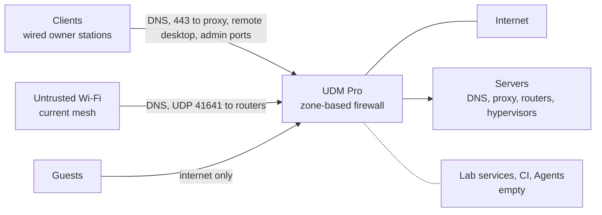

# Phase 2: Overview

## Goals, Segment Plan, and Zone Matrix

---

## Goals

- Split the flat LAN by role, so a compromised client or Wi-Fi device cannot reach every server port.
- Put each segment in its own firewall zone, so traffic between segments is blocked unless a policy allows it.
- Allow only the flows that are needed, each as a narrow policy: one source, one destination, the exact ports.
- Move devices in a fixed order with a canary first and the admin station last, so a mistake never cuts off the machine used to fix it.
- Prove each step with tests that would fail if the firewall were not in the path.

---

## Segment Plan

> **Example addressing.** The VLAN IDs and subnets below are examples for this write-up. They do not match the real plan.

| Segment | Role | Example VLAN | Example subnet | State after the first sitting |
|---|---|---:|---|---|
| Servers | Hypervisors, DNS pair, reverse proxy, subnet routers, service VMs | untagged | 10.0.10.0/24 | Unchanged; all servers still here |
| Lab services | Service VMs that do not need to sit with the core | 11 | 10.0.11.0/24 | Empty |
| CI | Build runners | 12 | 10.0.12.0/24 | Empty |
| Agents | Machines that run automation agents | 13 | 10.0.13.0/24 | Empty |
| Clients | The owner's wired workstations | 20 | 10.0.20.0/24 | Four wired stations |
| Untrusted Wi-Fi | The current mesh and every device on it | 21 | 10.0.21.0/24 | Whole mesh |
| Guests | Visitors | 30 | 10.0.30.0/24 | Empty |

Each segment is one network in one custom zone. The Servers network stays in the gateway's built-in Internal zone, alone.

---

## Zone Matrix

Default behavior on the UDM Pro zone-based firewall, as configured: custom zone to Internal, Internal to a custom zone, and custom zone to custom zone are blocked unless a policy allows the flow. Every zone may reach the internet.

| From \ To | Servers | Lab, CI, Agents | Clients | Untrusted Wi-Fi | Guests | Gateway admin | Internet |
|---|---|---|---|---|---|---|---|
| **Servers** | allow | block | block (one temporary allow, now paused) | block | block | default | allow |
| **Clients** | DNS, HTTPS to proxy, remote desktop; admin ports from owner stations | block | allow | block | block | default | allow |
| **Untrusted Wi-Fi** | DNS; VPN transport to the two subnet routers | block | block | allow | block | **block** 22, 80, 443 | allow |
| **Guests** | block | block | block | block | allow | **block** 22, 80, 443 | allow |
| **Lab, CI, Agents** | not yet written | not yet written | block | block | block | default | allow |

"Not yet written" means the segments are empty and their policies are written when the first guest moves in.

### The Narrow Allows

| # | Source | Destination | Ports | Why |
|---:|---|---|---|---|
| 1 | Clients | DNS resolver address | 53 TCP and UDP | Name resolution |
| 2 | Untrusted Wi-Fi | DNS resolver address | 53 TCP and UDP | Name resolution |
| 3 | Clients | Reverse proxy | 443 TCP | Every web service through one entry point |
| 4 | A named range of five owner stations | Servers | 22, 2222, 8006, 8007 TCP | SSH, git over SSH, the hypervisor and backup server web consoles |
| 5 | Untrusted Wi-Fi | The two subnet routers only | 41641 UDP | Direct Tailscale tunnels for a roaming laptop |
| 6 | Clients | Remote desktop server | 21115 to 21119 TCP and UDP | [RustDesk self-host ports](https://rustdesk.com/docs/en/self-host/) |
| 7 | Untrusted Wi-Fi, Guests | Gateway | 22, 80, 443 blocked | No router admin from untrusted networks |
| 8 | Old admin station address | Clients | temporary | Bridge during the move; paused, to be deleted |

Each gateway allow also needs a matching host firewall rule on the server it reaches. The gateway decides whether a packet may cross between zones. The host decides whether it accepts it.

---

## Logical Design

---

## Out of Scope for This Sitting

- Moving any server, VIP, router or hypervisor.
- The trusted and guest SSIDs, which wait for the new access point ([Phase 4](../phase-4-wireless-ssid-mapping/)).
- Monitoring changes per segment ([Phase 5](../phase-5-monitoring-and-operations/)).
